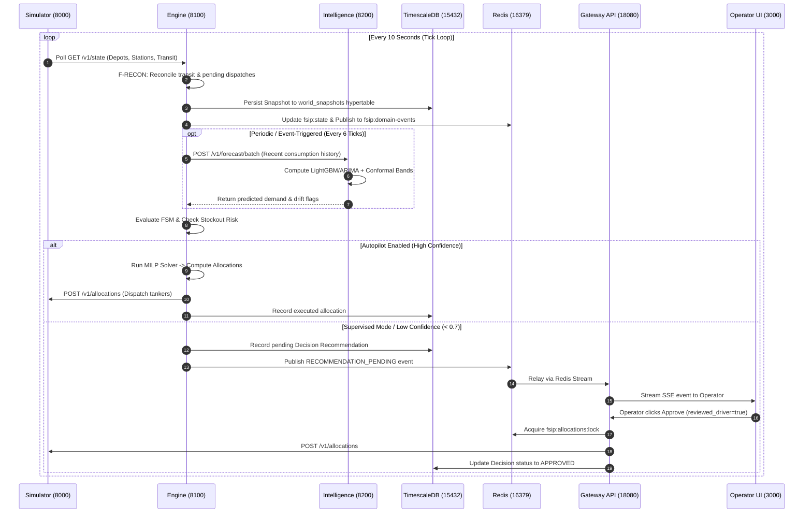

# Fuel Supply Intelligence & Resilience Platform (FSIP)
## System Architecture & Technical Specification

**Version:** 1.0.0  
**Status:** Complete & Locked  
**Target Release:** Production Release v1.0.0  

---

## 1. System Overview & Mission

The **Fuel Supply Intelligence & Resilience Platform (FSIP)** is an autonomous, mission-critical operations and logistics coordination platform designed to guarantee fuel supply resilience across nationwide distribution networks under normal, volatile, and extreme stress conditions (e.g., depot disruptions, pipeline halts, price shocks, and post-replenishment scarcity).

FSIP continuously senses physical telemetry from distributed depots and fuel retail stations, forecasts multi-horizon consumption, detects anomalies and operational drift, formulates optimal multi-modal distribution allocations via Mixed-Integer Linear Programming (MILP), enforces cognitive guardrails on human operators, and executes dispatch commands with sub-second deterministic safety.

```
                           +---------------------------+
                           |  Physical Simulator / IoT |
                           |  (External BUP Simulator) |
                           +-------------+-------------+
                                         | Telemetry & State (10s Ticks)
                                         v
   +-------------------------------------+-------------------------------------+
   |                              FSIP CORE PLATFORM                          |
   |                                                                           |
   |  +------------------+         +------------------+         +-----------+  |
   |  |   TimescaleDB    | <-----> |   Core Engine    | <-----> |   Redis   |  |
   |  | (State & Events) |         | (Recon, LP, FSM) |         | (Bus/Lock)|  |
   |  +------------------+         +--------+---------+         +-----+-----+  |
   |                                        |                         |        |
   |                                        v                         v        |
   |  +------------------+         +------------------+         +-----------+  |
   |  |   Intelligence   | <-----> |     FastAPI      | <-----> |  SSE / UI |  |
   |  | (Forecast/Drift) |         |   Gateway API    |         | (Stream)  |  |
   |  +------------------+         +--------+---------+         +-----+-----+  |
   +----------------------------------------|-------------------------|--------+
                                            v                         v
                           +----------------+-------------------------+--------+
                           |      Operations Center (Frontend / Grafana)       |
                           |  Human-in-the-Loop Supervision & Command Console  |
                           +---------------------------------------------------+
```

---

## 2. The 13 Core Platform Components

FSIP is partitioned into 13 decoupled, observable, and containerized components:

### 2.1. Physical Simulator (`simulator`)
- **Image:** `asifmahmoud414/bup-fuel-supply-simulator:1.0.0`
- **Port:** `8000` (Internal Docker network: `http://simulator:8000`)
- **Role:** Ground truth emulation of fuel distribution across 10 stations and 2 bulk fuel depots over 288-tick 48-hour operational cycles.
- **Contract Boundary:** External and immutable. FSIP interacts strictly through HTTP endpoints:
  - Read: `GET /v1/state`, `GET /v1/depots`, `GET /v1/stations`, `GET /v1/routes`
  - Action: `POST /v1/allocations`, `DELETE /v1/allocations/{id}`
  - Control (Dev/Test only): `POST /v1/sim/start`, `POST /v1/sim/reset`

### 2.2. Relational & Time-Series Ledger (`timescaledb`)
- **Engine:** PostgreSQL 16 with TimescaleDB Extension
- **Port:** `15432` (Internal: `5432`)
- **Key Schemas & Hypertables:**
  - `world_snapshots`: 10-second hypertable storing complete depot, station, and transit state.
  - `sim_runs`: Tracking distinct simulation lifecycles, baseline comparisons, and seed seeds.
  - `decisions`: Comprehensive ledger of all algorithmic recommendations, approval states, and review audit trails.
  - `allocations`: Physical dispatch logs, execution timestamps, route tags, and simulator IDs.
  - `anomalies`: Cryptographically logged sensor divergence, leak warnings, and reconciliation errors.
  - `contingency_audits`: N-1 operational resilience matrices and risk projections.

### 2.3. Low-Latency Message Bus & Distributed Lock (`redis`)
- **Engine:** Redis 7.2 Alpine
- **Port:** `16379` (Internal: `6379`)
- **Responsibilities:**
  - `fsip:domain-events`: High-throughput Redis Stream broadcasting real-time ticks, state changes, risk transitions, and alert notifications.
  - `fsip:state`: In-memory cached snapshot of latest network status for sub-5ms API reads.
  - `fsip:allocations:lock`: Distributed mutex preventing duplicate dispatches and double-spend allocations during concurrent operator approvals.

### 2.4. Core Optimization & State Engine (`engine`)
- **Service:** `services/engine` (Python 3.11, AsyncIO, PuLP/CBC, SQLAlchemy)
- **Port:** `8100`
- **Core Loops & Submodules:**
  - `TickLoop`: Polls simulator every tick (10s), synchronizes world state, and guarantees processing completes within the 2.0s execution budget.
  - `F-RECON`: Reconciliation protocol reconciling simulator reported transit vs internal allocation ledgers, handling route disruptions and dropped dispatches.
  - `Finite State Machine (FSM)`: Implements transitions across `NORMAL`, `DEGRADED`, `SAFE_HOLD`, and `NO_FEASIBLE_ROUTES`.
  - `LP Optimizer`: Integer programming solver generating cost-optimal, stockout-minimizing dispatches across available fleet tankers and routes.
  - `Scarcity Policy`: Post-tick-212 rationing logic preserving minimum service levels across all stations when external pipeline supplies stop.

### 2.5. Intelligence & Predictive Analytics (`intelligence`)
- **Service:** `services/intelligence` (FastAPI, Scikit-learn, LightGBM, Statsmodels)
- **Port:** `8200`
- **Capabilities:**
  - `Multi-Horizon Demand Forecasting`: 12-tick, 24-tick, and 48-tick hourly consumption forecasts per station.
  - `Model Fallback Hierarchy`: Ensemble LightGBM / ARIMA with automatic fallback to Seasonal Moving Median on data sparseness or extreme volatility.
  - `Conformal Prediction`: Split conformal prediction generating calibrated 90% coverage bands for conservative safety stock estimation.
  - `Concept Drift & Sensor Anomaly Detection`: Page-Hinkley and Wasserstein distance monitoring detecting behavioral consumption shifts and phantom demand.

### 2.6. Central Gateway API (`api`)
- **Service:** `services/api` (FastAPI, Pydantic v2, SSE-Starlette)
- **Port:** `18080`
- **Security & Features:**
  - Role-Based Access Control (RBAC): `viewer`, `operator`, `admin` tokens.
  - Per-IP Token-Bucket Rate Limiting (120 req/min general, 30 req/min approvals).
  - Server-Sent Events (SSE) `/api/stream` streaming live domain events directly to frontends.
  - Cognitive Forcing: Rejects allocation approvals $> 5000\text{L}$ or confidence $< 0.7$ lacking explicit `"reviewed_driver": true` confirmation.

### 2.7. Operations Console Dashboard (`frontend`)
- **Framework:** React 18, TypeScript, Vite, Tailwind CSS, Lucide Icons, Recharts
- **Port:** `3000`
- **Operator Workspaces:**
  - *Network Topology Map:* Real-time node status, tank fill percentages, tanker positions.
  - *Risk & Stockout Heatmap:* Hours-to-dry projections, uncertainty intervals, priority alerts.
  - *Recommendation & Decision Ledger:* One-click human approval/rejection with cognitive checks.
  - *Historical Replay / Time-Travel:* Interactive slider scrubbing through historical ticks in read-only mode without mutating live state.
  - *What-If Sandbox:* Parameter adjustment (demand surge, route closure) testing optimization response.

### 2.8. Standalone Break-Glass Console (`break-glass`)
- **File:** `frontend/public/break-glass.html`
- **Port:** Directly accessible via web server or local disk
- **Role:** Zero-dependency, pure vanilla HTML/JS fallback interface allowing direct emergency allocation dispatches to the simulator even if the API, Engine, or React build are completely down.

### 2.9. Evaluation & Benchmarking Harness (`evaluation`)
- **Directory:** `evaluation/`
- **Capabilities:**
  - Deterministic replay of standard evaluation scenarios (Baseline 96-tick, Depot Outage, Route Disruption, Extreme Panic Surge).
  - Automated calculation of Service Level ($SL \ge 99\%$), Average Stockout Minutes, Fleet Utilization, and Cost per Liter.

### 2.10. Metrics Collection Engine (`prometheus`)
- **Port:** `9090`
- **Scrape Targets:** Engine (`8100/metrics`), API (`18080/metrics`), Intelligence (`8200/metrics`), cAdvisor (`8081`).
- **SLO Rules:** Precomputed recording rules evaluating 30-minute and 6-hour error budgets and latency thresholds.

### 2.11. Observability Visualizer (`grafana`)
- **Port:** `13001` (Credentials: `admin`/`admin`)
- **Provisioned Dashboards:**
  1. *FSIP System Overview:* High-level health, RPS, latency p95, active alerts.
  2. *FSIP Engine & Optimization:* Tick duration, solver latency, FSM state, allocation volume.
  3. *FSIP Risk & Intelligence:* Model drift, forecast MAPE, stockout hours, conformal intervals.
  4. *FSIP Resilience & Chaos:* Error budget burn rates, recovery times, chaos drill telemetry.

### 2.12. Alert Router & Escalator (`alertmanager`)
- **Port:** `9093`
- **Routing:** Groups alerts by severity (`P1_CRITICAL`, `P2_WARNING`), routes critical events to API domain webhook, and fans out to notification dispatchers.

### 2.13. Centralized Log Aggregator (`loki`) & Promtail
- **Port:** `3100`
- **Role:** High-volume indexed ingestion of stdout/stderr logs from all engine, api, and intelligence containers.

---

## 3. End-to-End Data & Decision Flow



---

## 4. Key Architectural Safeguards & Design Principles

1. **Simulator Immutability:** The external simulator codebase and binary container are strictly unmodified. All integration adheres strictly to its documented HTTP contracts.
2. **Sub-2s Engine Budget:** Every tick loop (ingestion, reconciliation, optimization, and state dispatch) executes in $< 2000\text{ms}$, well within the 10-second tick boundary.
3. **Double-Spend Prevention:** Distributed mutex locking on tanker and depot resources ensures no concurrent operator actions can dispatch duplicate allocations.
4. **Cognitive Forcing:** Human operators cannot blindly approve high-volume or low-confidence dispatches; the platform forces explicit verification protocols.
5. **Fail-Safe Degradation:** If the solver fails, TimescaleDB disconnects, or simulator connectivity hiccups, the engine gracefully transitions through `DEGRADED` and `SAFE_HOLD`, falling back to heuristic priority dispatch or frozen safe holds.
