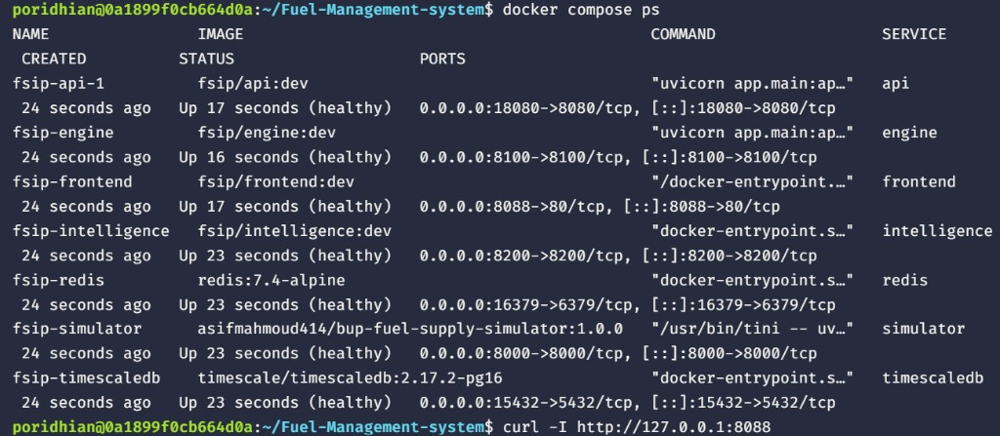
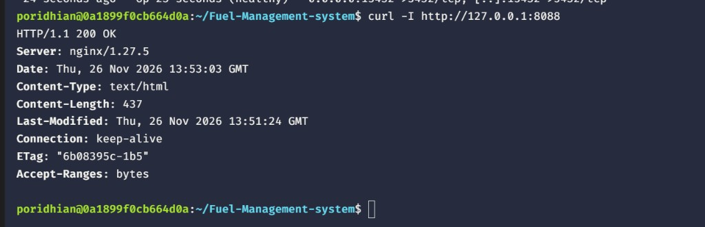
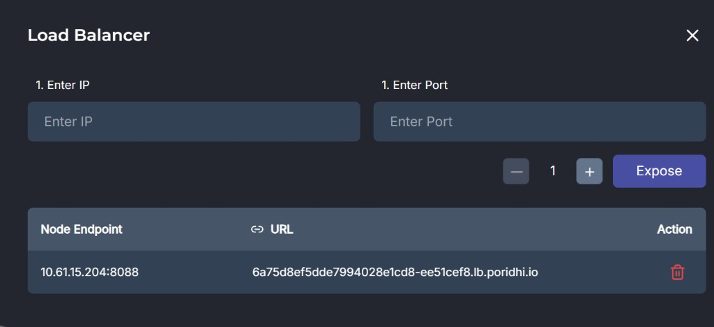

# Host FSIP on Poridhi Lab & Share via Load Balancer

Run the Fuel Supply Intelligence Platform **inside a Poridhi Lab / Playground VM**, then publish the operator console with Poridhi **Load Balancer** so examiners can open a public `*.lb.poridhi.io` URL.

> **Why not your home PC?**  
> The Load Balancer only reaches IPs on the Poridhi lab network. A home Wi‑Fi address (e.g. `192.168.x.x`) will time out with **504**.

---

## Prerequisites

- An active **Poridhi Lab** session (web terminal)
- Docker + Docker Compose on the lab VM
- This repository cloned on the lab

---

## 1. Open the lab and find the node IP

In the Poridhi terminal:

```bash
hostname -I
```

Example output:

```text
10.61.15.204  100.80.12.7  172.17.0.1
```

| IP | Use? |
|---|---|
| `10.61.15.204` (or similar `10.x`) | **Yes** — primary lab IP for Load Balancer |
| `100.x.x.x` | Fallback only if `10.x` fails |
| `172.17.0.1` | **No** — Docker bridge |

---

## 2. Clone and enter the project

Folder names are **case-sensitive**. After clone, confirm with `ls`:

```bash
cd ~
git clone https://github.com/IamAsif53/Fuel-Management-System.git
ls
cd ~/Fuel-Management-system   # use the exact name ls shows (Tab-complete helps)
ls                            # should list docker-compose.yml
```

---

## 3. Configure port and start the stack

Avoid host port `3000` (often reserved on Poridhi). Use **8088** for the frontend:

```bash
cp .env.example .env
echo "FE_HOST_PORT=8088" >> .env
docker compose up -d --build
```

Wait until containers are healthy:

```bash
docker compose ps
```

### Evidence — stack healthy on Poridhi



---

## 4. Verify locally on the lab

```bash
curl -I http://127.0.0.1:8088
```

Expect `HTTP/1.1 200 OK` from nginx.

### Evidence — frontend responds on 8088



---

## 5. Expose with Poridhi Load Balancer

In the lab UI, open **Load Balancer** and set:

| Field | Value |
|---|---|
| **IP** | Lab IP from step 1 (e.g. `10.61.15.204`) |
| **Port** | `8088` |

Click **Expose**. Copy the generated URL (`*.lb.poridhi.io`).

### Evidence — public endpoint registered



Share that URL with examiners. Keep the lab session (and `docker compose`) running while they review.

---

## Quick checklist

- [ ] App runs **on the Poridhi lab**, not only on a laptop  
- [ ] `curl -I http://127.0.0.1:8088` → **200** inside the lab  
- [ ] Load Balancer uses lab **`10.x` IP** + port **`8088`**  
- [ ] Lab timer / session still active when sharing the link  

---

## Troubleshooting

| Symptom | Likely cause | Fix |
|---|---|---|
| LB **504** / timeout | Origin is home LAN IP, or app not on lab | Deploy on lab; use `hostname -I` IP |
| Port **3000** rejected | Reserved on Poridhi | Set `FE_HOST_PORT=8088` |
| `cd … No such file` | Wrong casing | `ls` then `cd` the exact folder name |
| `docker compose` “no configuration file” | Not in repo root | `cd` until `docker-compose.yml` is visible |
| Clone folder missing | Clone unfinished / wrong path | `cd ~ && ls` and re-clone if needed |

---

## Related

- Main project README: [`../../../README.md`](../../../README.md)
- Local Docker quick start: see **Getting Started** in the root README
