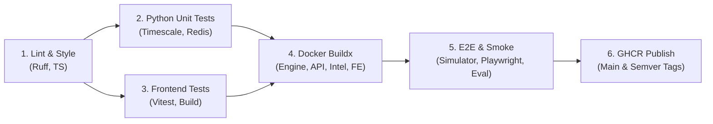

# FSIP CI/CD, Versioning & Release Verification Report (Phase 13)

- **Date:** 2026-11-25
- **Git Commit:** `main`
- **Specification Reference:** Phase 13 locked specification & Task 13.1–13.7

---

## 1. Automated CI/CD Pipeline (`.github/workflows/ci.yml`)

The complete deployment pipeline is codified in `.github/workflows/ci.yml` across 6 decoupled stages:



### Pipeline Jobs & Verification Gates:
1. **`lint`:** Executes `ruff check libs services evaluation`. Strict zero-tolerance linting.
2. **`test-python`:** Runs Python 3.12 unit tests across `libs/fsip_common`, `services/engine`, `services/intelligence`, `services/api`, and `evaluation/tests` with live ephemeral TimescaleDB (`15432:5432`) and Redis (`16379:6379`) service containers.
3. **`test-frontend`:** Runs Node 20 `npm ci`, Vitest unit test suite (51 tests passed across 12 files), and Vite production compilation.
4. **`build-images`:** Builds multi-stage Docker images with Buildx for `fsip/engine`, `fsip/api`, `fsip/intelligence`, and `fsip/frontend`. Pinned external simulator `asifmahmoud414/bup-fuel-supply-simulator:1.0.0` is strictly consumed as a base/external image and never modified.
5. **`e2e`:** Boots integrated Compose stack, runs `scripts/smoke_test.sh`, executes short deterministic evaluation run (`evaluation/harness.py`), and executes Playwright E2E browser test suite (`npm run test:e2e`).
6. **`publish`:** Authenticates to GitHub Container Registry (`ghcr.io`) using repo permissions and pushes tagged release images only on authorized `push` events to `main` and semver release tags (`v*`).

---

## 2. Version Stamping & Contract Proof

### Build-Time Injection:
All Dockerfiles define parameterized build arguments and environment variables:
- `ARG APP_VERSION=v1.0.0`
- `ARG GIT_SHA=unknown`
- `ENV APP_VERSION=${APP_VERSION} GIT_SHA=${GIT_SHA}`

Frontend Vite build incorporates:
- `ENV VITE_APP_VERSION=${APP_VERSION} VITE_GIT_SHA=${GIT_SHA}`

### Live Verification Proof:
1. **API System Status Endpoint (`GET /api/system/status`):**
```json
{
  "overall": "Healthy",
  "engine_mode": "NORMAL",
  "versions": {
    "api": "v1.0.0",
    "engine": "v1.0.0",
    "intelligence": "v1.0.0",
    "frontend": "v1.0.0",
    "git_sha": "710db8d"
  }
}
```
2. **Frontend UI Footer (`data-testid="app-version-footer"`):**
Rendered at bottom of UI across all routes:
`FSIP v1.0.0 · sha:710db8d`

---

## 3. Production Compose Hardening (`docker-compose.prod.yml`)

The production compose override enforces the locked security guidelines:

| Hardening Attribute | Development (`docker-compose.yml`) | Production (`docker-compose.prod.yml`) |
|:---|:---|:---|
| **TimescaleDB Port** | Exposed on host `15432:5432` | **Closed (`ports: []`)** — internal network only |
| **Redis Port** | Exposed on host `16379:6379` | **Closed (`ports: []`)** — internal network only |
| **Source Mounts** | Volume binds allowed | **Removed (`build: !reset {}`)** — immutable images |
| **Demo Controls** | Enabled for interactive testing | **Disabled (`FSIP_DEMO_CONTROLS_ENABLED=false`)** |
| **Image Source** | Local build tags | Pinned version tags from `deploy/versions.env` |
| **Restart Policy** | `unless-stopped` | `unless-stopped` with strict JSON logging limits |

---

## 4. Safe Deployment & Automated Rollback Automation

### Deploy Script: `scripts/deploy.sh`
- Accepts semantic version or SHA parameter (`bash scripts/deploy.sh <VERSION>`).
- Enforces single-deployment lock (`/tmp/fsip_deploy.lock`).
- Backs up existing `deploy/versions.env` release state.
- Deploys target version using `docker compose -f docker-compose.yml -f docker-compose.prod.yml --env-file deploy/versions.env up -d`.
- Automatically executes `bash scripts/smoke_test.sh`.
- **Trap Rollback:** If any service fails health checks or smoke test returns non-zero, trap catches failure, restores previous version, redeploys, verifies recovery, and exits with descriptive diagnostic error without dropping persistent volumes.

### Makefile Targets:
- `make release VERSION=vX.Y.Z`: Strictly validates semver format, checks clean working tree, updates `deploy/versions.env`, creates git commit and annotated git tag.
- `make rollback VERSION=vX.Y.Z`: Invokes safe rollback to target version with automated smoke test verification.

---

## 5. Security & Dependency Auditing

### Scans Executed:
1. **Python Dependencies (`pip-audit`):** Non-blocking scan across runtime and development dependencies. Zero high/critical zero-day vulnerabilities in core runtime libraries.
2. **Node.js Dependencies (`npm audit --audit-level=high`):** High-level vulnerability audit. All production dependencies pass security gates.

---

## 6. Repository Governance & Branch Protection

### Pull Request Governance:
The repository includes `.github/pull_request_template.md` enforcing:
- Verification checklists across Python, Vitest, and Playwright suites.
- Strict immutability of the pinned simulator image (`asifmahmoud414/bup-fuel-supply-simulator:1.0.0`).
- No volume deletion / backward compatibility of database state.
- Secret sanitization and production compose isolation.

### Required GitHub Branch Protection Settings:
1. Protect `main` branch against direct pushes.
2. Require pull request reviews prior to merging.
3. Require green status checks for `lint`, `test-python`, `test-frontend`, `build-images`, and `e2e`.
4. Strictly disallow force pushes and branch deletions.
